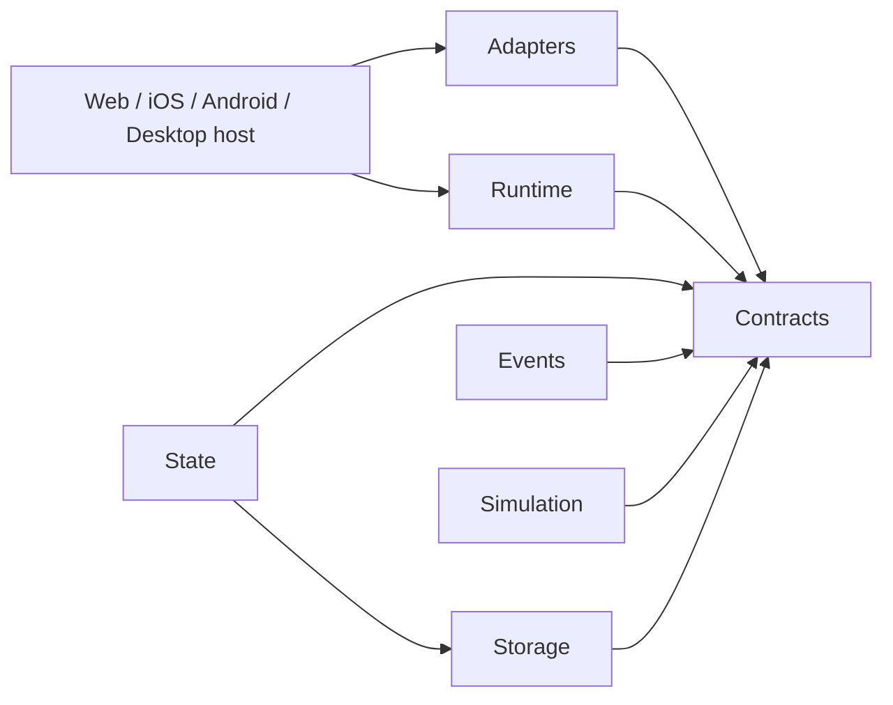

# Architecture

MAX-CORE is a library, not a product application. Dependencies flow inward:



Every platform capability enters through an explicit interface. No module
imports Portal-OS1, MAX Games, MAX Media, MAX Art, or other product-specific code.
The `intelligence/` directory reserves a neutral extension point without bundling
a model provider. Runtime and storage never infer a product or tenant identity.

## Contracts

All public APIs ship TypeScript declarations and use strict compilation.
`tests/contracts.ts` verifies implementation compliance and rejects invalid event
payloads, unknown events, mutable state writes, and non-JSON state fields.

| Interface | Operations | Guarantee |
| --- | --- | --- |
| `StateContract<T>` | get, set, patch, subscribe, unsubscribe, rehydrate | Immutable snapshots; serialized, persisted updates |
| `EventContract<E>` | emit, subscribe, unsubscribe | Name-to-payload mapping; synchronous routing |
| `SimulationContract<S>` | start, pause, resume, stop, update, get | Explicit fixed-step lifecycle |
| `StorageContract` | get, set, remove | Atomic replacement per key; rejected writes do not partially commit |
| `RuntimeContract` | register, boot, shutdown | Ordered start, reverse stop, boot rollback |
| `AdapterContract` | platform, storage, telemetry, notifications, purchases | Shared host capability surface |

`StorageAdapter` adds `persistent` (durable backend vs volatile memory). This does
not mean the OS/browser has granted protection from eviction; use
`detectPersistence()` for that distinction. Missing values are `undefined`;
stored `null` is a real value.

Payloads are finite JSON: strings, booleans, finite numbers, null, arrays, and
plain objects. Functions, undefined, host objects, cycles, and nonfinite numbers
are rejected. Boundaries clone and deeply freeze payloads to remove mutable
aliases. Use `type` object shapes for generic state schemas, or explicitly add an
index signature when using interfaces. Applications own schema decoding and
migration; MAX-CORE cannot infer the meaning of their persisted data.

## State

```ts
import { State, MemoryStorage } from '@max/core';
const state = new State({ count: 0 }, {
  storage: new MemoryStorage(), key: 'counter',
  decode(value) {
    if (!value || typeof value !== 'object' || Array.isArray(value)
      || typeof value.count !== 'number') throw new TypeError('Invalid counter');
    return { count: value.count };
  },
});
await state.rehydrate(); // false if absent; throws on invalid persisted data
const listener = (next: Readonly<{ count: number }>) => console.log(next.count);
const dispose = state.subscribe(listener);
await state.set({ count: 1 });
await state.patch({ count: 2 }); // shallow merge, nested values replaced in full
state.unsubscribe(listener); // or dispose()
```

`get()` is synchronous. `set`, `patch`, and `rehydrate` serialize in call order.
Input is copied at invocation. Patches merge with the latest committed snapshot.
Persistence completes before observers run; failed persistence leaves the state
unchanged. Rehydration validates data before publishing and does not rewrite it.

Observers run synchronously in registration order using a snapshot of the
subscription set. Removal during notification affects the next update. Every
observer runs even if another throws. An `AggregateError` then rejects the update
promise **after the state has committed**. Do not retry a committed mutation just
because an observer failed. Listeners return void; handle async work explicitly.

## Events

```ts
import { EventBus } from '@max/core';
type Messages = { ready: { service: string }; tick: number };
const events = new EventBus<Messages>();
const dispose = events.subscribe('ready', ({ service }) => console.log(service));
events.emit('ready', { service: 'simulation' });
dispose();
```

`Event` is an alias for `EventBus`. Inject one bus from the host composition root
into all systems to obtain global routing. There is no hidden singleton shared
between users, tests, or runtimes. Events are in-process; network/worker routing
requires a host bridge. Delivery is synchronous, ordered, and reentrant. Payloads
are copied and frozen. Errors aggregate after every matching listener runs.
Subscription changes affect the next emission. Registering the same callback
twice is idempotent. There is no replay buffer or implicit persistence.

## Verification

`npm test` checks type contracts and behavior for all modules, including failure
paths, database loss, tenant isolation, and retry idempotence. Production modules
have zero runtime dependencies. `fake-indexeddb` and TypeScript are development
only. Tests use Node's built-in SQLite engine to execute actual D1 SQL through a
structural binding. No external provider credentials are needed for local tests.
