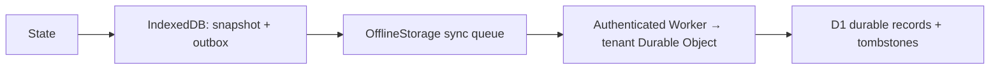

# Storage and offline sync

## Four layers



The browser stores the snapshot and queue in **one atomic key replacement**.
Native hosts substitute a `StorageContract` with the same atomicity guarantee.
`OfflineStorage` implements `StorageContract`, so it can be passed to `State`.
Calls serialize per instance. **Use one writer instance per local namespace.**
Multiple browser tabs must coordinate ownership in the host (for example a shared
worker); independent read-modify-write queues on the same key are unsupported.

```ts
import { IndexedDBStorage, OfflineStorage, HttpSyncTransport, State } from '@max/core';
const local = new IndexedDBStorage(indexedDB, 'my-neutral-runtime');
const offline = new OfflineStorage(local, new HttpSyncTransport('/api/core-sync'));
const state = new State({ count: 0 }, {
  storage: offline, key: 'counter',
  decode(value) {
    if (!value || typeof value !== 'object' || Array.isArray(value)
      || typeof value.count !== 'number') throw new TypeError('Invalid counter');
    return { count: value.count };
  },
});
await state.rehydrate();
await state.patch({ count: 1 }); // durable local commit; works offline
try {
  await offline.sync();
  await state.rehydrate(); // publish any remote conflict winner
} catch (error) { /* host schedules retry/backoff and shows status */ }
```

## Queue and conflict semantics

`set` and `remove` append an operation and update the local snapshot atomically.
Deletes create persistent tombstones. `pending()` reports queued operations.
`sync()` sends the queue and receives the complete authoritative snapshot. Local
writes wait while a sync is in flight; HTTP transport has a 15-second timeout by
default. Inject fetch to attach host authentication or a different timeout.
Only one successful remote acknowledgement plus a successful local commit clears
the queue. Failed/malformed/incomplete responses retain it. A response lost after
remote commit is safe to retry.

Conflict resolution is whole-key last-writer-wins using `(timestamp, id)`:

1. Timestamp is `max(now(), localLogicalClock + 1)` in integer milliseconds.
2. Ties compare unique ASCII operation IDs in binary lexicographic order.
3. The greater tuple wins; the same operation replay is idempotent.

The local clock advances to the largest remote timestamp. IDs default to
`crypto.randomUUID()`; hosts without that API must inject a globally unique ID
function (1–128 ASCII letters, digits, `_`, `-`). Test clock/ID hooks are available.
D1 rejects an entire incoming batch if any timestamp exceeds server time by more
than five minutes (configurable with `maxFutureSkewMs` and a trusted `now` clock).
This prevents peer-supplied extreme timestamps from exhausting client clocks.
Fix an ahead-of-server device clock or wait for the skew window before retrying;
queued data stays local. Hosts should keep this window small. Within that window,
clock skew can make one writer dominate until clocks catch up. This is a
deterministic conflict policy, not causal ordering or a CRDT. A key's JSON value
is replaced as a whole; split independently editable fields into separate keys.
Do not reuse operation IDs with different payloads. Keep tombstones until an
application-owned compaction protocol can prove old writers cannot resurrect data.

This initial protocol uses full snapshots and retains queued operations until
acknowledgement. It targets bounded application state. The endpoint defaults to a
1 MiB request limit; hosts must bound writes/queues to deployment limits. Large
histories need a separately designed paginated/chunked protocol and retention
policy. D1 transaction/batch and response limits also apply. There is no hidden
background polling, unbounded retry loop, or network request during construction.

## IndexedDB and Safari recovery

`IndexedDBStorage` uses schema version 1 with a `records` object store. Writes
resolve on **transaction completion**, including rejection on late abort. Reads
validate, copy, and freeze data. Close/version changes invalidate the connection;
subsequent operations reopen it. A blocked upgrade rejects so the host can ask
other clients to close. Explicit `recover()` closes/reopens a failed connection.
Do not share its database name with an unrelated schema.

For Safari/private-mode/eviction failures:

1. Catch the storage failure and preserve the user's unsaved input in host UI.
2. Call `local.recover()` to reopen; do not silently claim durable success.
3. Once storage and network work, call `offline.recover()` to retrieve the server
   snapshot, then `state.rehydrate()` to notify subscribers.
4. If storage remains unavailable, surface a persistence error or explicitly
   select a volatile session with a clear host policy.

If local data is gone, **only remotely acknowledged data is recoverable**. Unsynced
changes whose only copy was deleted are lost. If the network is also unavailable,
recovery must wait. Invalid document versions or corrupt data reject; core does
not delete a potentially recoverable queue automatically. `persistent: true`
describes the backend, not an OS guarantee against eviction.

## Cloudflare deployment boundary

`@max/core/storage/server` exports `D1_SCHEMA`, `D1SyncStore`, and
`DurableObjectSyncEndpoint`. Apply `D1_SCHEMA` through a D1 migration. Bind D1 and a
Durable Object namespace in your host Worker. An illustrative object wrapper:

```ts
import { DurableObjectSyncEndpoint, D1SyncStore } from '@max/core/storage/server';
// Env and DurableObjectState come from your host's Cloudflare worker types.
export class SyncObject {
  private endpoint: DurableObjectSyncEndpoint;
  constructor(state: DurableObjectState, env: Env) {
    // Route each authenticated tenant to exactly one named object in the Worker.
    this.endpoint = new DurableObjectSyncEndpoint(
      new D1SyncStore(env.DB, state.id.toString()),
    );
  }
  fetch(request: Request) { return this.endpoint.fetch(request); }
}
```

The outer Worker authenticates the caller, derives a trusted tenant namespace,
routes to its object, and enforces authorization, quotas and any required CORS.
Never accept an arbitrary tenant scope from a client payload. The helper endpoint
is an internal handler, not a standalone authenticated public API. Partition
local database names/namespaces on account changes as well.

The object serializes exchanges. SQL uses bound parameters and an atomic D1 batch
with conditional upserts; scope is part of the primary key. D1 commits **before**
acknowledgement, so restarting/evicting the Durable Object cannot erase an
acknowledged queue. Keep the binding on primary reads or use a consistent D1
session if enabling read replication. The response is the tenant's full snapshot,
including tombstones. POST accepts `{ records: SyncRecord[] }`; success returns
`SyncRecord[]`; malformed bodies return 400, oversized bodies 413, unsupported
methods 405, and backend failures 503. No customer payload is echoed in errors.

Local tests execute the production SQL on SQLite, reconstruct endpoint/store
instances, exercise the HTTP transport, and simulate IndexedDB loss. They do not
certify Cloudflare deployment, native storage bridges, or actual Safari behavior.
